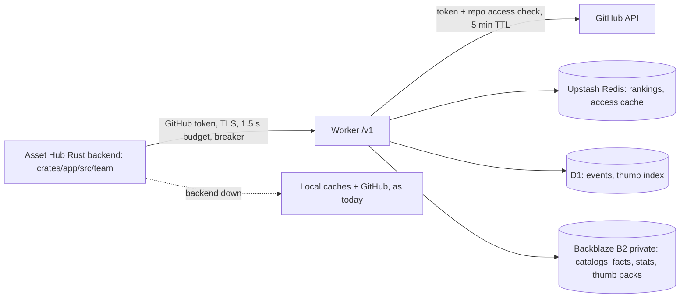

# Team backend: remote cache and popularity

> Note (phase 3h): the TypeScript Worker sources were replaced by the Rust Worker in phase 3h and removed. `backend/` now holds only Rust, the contract tests and scripts.

## Overview

Asset Hub has no backend today. Teammates share listings, measurements and thumbnails through the GitHub repo in `INDEX_REPO` (`crates/app/src/index_repo.rs:19`), which is **public**. This plan adds a small backend so that:

- the team cache moves to private storage and is shared per repo, behind a GitHub access check;
- popular assets (team views + sends to Unity) sort first when browsing, draw their thumbnails first, and have their dependencies fetched ahead of time;
- when the backend, Redis, or both fail, the app works exactly as today, minus the team features and the remote cache.

Stack (from `plans/reports/researcher-261109-1416-backend-free-tier-services.md`): Cloudflare Workers + D1 + Backblaze B2 + Upstash Redis, all on free tiers.

## Goals

| # | Goal | Priority |
|---|------|----------|
| 1 | A first branch open on a fresh Mac uses the team cache from private storage | P1 |
| 2 | Popular assets sort first, draw first, and open in 2–4 s | P1 |
| 3 | Backend or Redis outage never blocks or slows local results | P0 |

## Architecture

Rules every phase keeps:

- The Worker never stores or logs the GitHub token; it keeps only `sha256(token)` as a cache key.
- Every response is checked against the caller's access to that repo.
- D1 is the source of truth for events; Redis rankings are derived and rebuilt by cron every 3 hours. If Redis is down, popularity is off and the app uses its local order.
- Reading a repo's cache needs read access to that repo on GitHub; writing needs push access. The desktop validates everything it takes in (repo binding, shape, size, and SHAs in that repo).
- The desktop never waits for the backend before showing local results.

## Phases

| # | Phase | Status | Depends on |
|---|-------|--------|------------|
| 1 | [Shared index access (handled by the owner)](./phase-01-start.md) | Skipped | — |
| 2 | [Backend foundation: Worker, bindings, auth](./phase-02-backend-foundation.md) | Done | — |
| 3 | [Backend data API: events, popularity, cache objects, thumbs](./phase-03-backend-data-api.md) | Done | 2 |
| 3b | [Move blob storage from R2 to Backblaze B2](./phase-03b-backblaze-b2-storage.md) | Done | 3 |
| 3c | [Thumbnails in D1 shards (off B2)](./phase-03c-d1-thumbnail-shards.md) | Folded into 3g (built in Rust, not finished in TypeScript) | 3b, 5 |
| 3d | [Rust Worker: toolchain, shared pack crate, skeleton](./phase-03d-rust-toolchain-and-skeleton.md) | Done | 3b |
| 3e | [Black-box HTTP contract suite, green on TypeScript](./phase-03e-black-box-contract-suite.md) | Done | 3d |
| 3f | [Rust: auth, Redis, events, popularity, cache objects, thumbnail list](./phase-03f-rust-core-routes.md) | Done | 3e |
| 3g | [Rust: thumbnails on D1 shards (phase 3c) and the client epoch](./phase-03g-rust-thumbs-d1-shards.md) | Done | 3f, 5 |
| 3h | [Measure, cut over to Rust, remove TypeScript](./phase-03h-rust-cutover.md) | Blocked: first cutover rolled back on CPU (see reports/rust-cutover.md); waits for 3i | 3g, 3i |
| 3i | [Rust CPU: faster thumbnail routes, test Worker, revised gate](./phase-03i-rust-cpu-optimization.md) | Todo | 3g |
| 4 | [Desktop backend client with fail-open behavior](./phase-04-desktop-backend-client.md) | Done | 3b (contract) |
| 5 | [Remote cache sync; retire the GitHub index repo mode](./phase-05-remote-cache-sync.md) | Done (index-repo retirement waits for phase 7) | 4 |
| 6 | [Team popularity, popular-first order, prefetch, timings](./phase-06-team-popularity-and-prefetch.md) | Done | 4, 5 (shared files) |
| 7 | [Deploy, real-app fault test, docs](./phase-07-deploy-verify-docs.md) | In progress (7.1, 7.2 done) | 3b, 3h, 5, 6 |

Phase 1 is out of scope: the owner moves the index repo and manages its access.

### Rust rewrite of the Worker (phases 3d–3h)

Decision 2026-11-16 (user, settled): rewrite the Worker in Rust (`workers-rs` 0.8.7, compiled to WebAssembly) for future-proofing. Phase 3c is built directly in Rust (phase 3g). The TypeScript Worker stays the reference and stays live until the cutover in phase 3h. The HTTP contract stays byte-identical: routes, status codes, error codes, headers, the pack format and the limits. The only changes are the 3c changes.

**Trade-off:** the rewrite brings no user-visible speed gain. Measured: Worker CPU is 4–9 ms and wall time 40–70 ms, while client latency (250–430 ms) is mostly network and I/O. The cost is about 7–10 working days and a second toolchain (rustup with `wasm32-unknown-unknown`, `worker-build`). The gain is one language across the desktop and the Worker, a shared pack codec crate (`crates/pack`), and compile-time checks in the Worker. Details: `plans/reports/planner-261116-1419-rust-worker-rewrite.md`.

Phases 4–6 target the Tauri app. The Tauri + Rust migration reached parity (`plans/261109-1425-tauri-rust-bun-migration/plan.md`, phase 09 Done), and the Electron `src/main/*.ts` code is gone. The client lives in a new `crates/app/src/team/` module. It hangs off the per-account `Session` in `crates/app/src/hub.rs`, and the page gets status, popularity and events through typed commands (`ui/src/bindings.ts`). The backend contract from phases 2–3b stays as built, and the live Worker is `https://asset-hub-api.asset-hub-team.workers.dev`. Thumbnail list items carry `rev`, and the cursor is `after=<rev>:<name>`.

Run phases 4 → 5 → 6 in order, with one implementer. Phases 5 and 6 both edit `crates/app/src/hub.rs`, `crates/app/src/commands/parse.rs` (`browse_assets`), `crates/app/src/lib.rs`, `crates/app/src/command_names.rs`, `crates/app/capabilities/main.json`, `crates/app/src/dto.rs`, `ui/shared/ipc.ts`, `ui/src/api.ts`, the generated `ui/src/bindings.ts` and the en/vi/ko locales. Phases 4 and 6 both edit `ui/src/screens/Browse.tsx`.

## Success Criteria

- [ ] `cd backend && npm test` passes, including revoked-access and cross-repo tests. After phase 3h this runs the Rust unit tests and the black-box contract suite against the Rust Worker.
- [ ] `cargo test --workspace`, `bun run test` and `bun run typecheck` pass at the repo root.
- [ ] Fault tests (hang, DNS failure, 401/403/429/500, corrupt payload) show local results with no added wait beyond the 1.5 s budget, and a "team features offline" indicator.
- [ ] Browse defaults to popular-first; search keeps match strength first.
- [ ] After prefetch, a top-20 asset on a branch opened for the first time shows its preview within 4 s of being selected (task 7.4).
- [ ] Worker, D1, Backblaze B2 and Upstash usage stays inside the free tiers in the first week.

## Review

An independent review on 2026-11-09 (kongming, gpt-6-astra, medium; receipt MATCH) returned no-go with 5 high findings. All were applied:
- validation of remote data before merging (phase 5);
- corrected references: the `prefabfx3` fact kind, the private `snapshot`, and the unexported `Deps`;
- prefetch limited to what it can control, with no timeout race around the git lock;
- whole-operation deadlines, plus clean-up on account change;
- Redis pipelining, and no D1 scan on a Redis outage.

Medium findings were applied too:
- a composite thumbnail cursor with version-aware replacement;
- rate-limit handling, and push access required for writes;
- a cron-only rebuild, so there is no rename race;
- honest pass conditions in phases 1 and 7.

## Assumptions (defaults; confirm or change before phase 2)

The question popup was declined, so these defaults were chosen. Each is easy to change.

1. "Accessibility feature" means the backend-only team features: team popularity, popular-first order, and team prefetch. Without the backend, order falls back to branch count, then personal history (recent and favorites).
2. Teammates are trusted cache writers, as with today's index repo; writing needs push access to the repo.
3. The owner moves the shared index repo to their own GitHub and manages its access outside this plan. The app keeps using it until phase 5 ships; the shared-folder mode stays.
4. Revoked GitHub access stops working on the backend within 5 minutes (access cache TTL 300 s, no sliding expiry).
5. A team owner creates a company-owned Cloudflare account and an Upstash account.
6. Popularity counts are anonymous per repo and asset (no login stored with them), weighted to recent use (14-day half-life), refreshed every 3 hours, and prefetch is capped at the top 20 per branch.
7. `ALLOWED_OWNERS` = `supercent-io`, `SCVN-Dan` (the GitHub owners whose repos the team browses). Check the list against the repos in the catalog before deploy.

## Open questions

- Does the company already have a Cloudflare account?
- Which GitHub owners belong in `ALLOWED_OWNERS`?
- Should views by the developer's own account count toward popularity?

### Open questions for the Rust phases (each has a default, so work is not blocked)

1. **Dev builds and the live Worker.** Default: debug builds read the live Worker, and they write team data only with `ASSETHUB_INDEX_CONTRIBUTE` set (the existing `auto_contribute` rule). Alternative: debug builds stay offline unless `ASSETHUB_BACKEND_URL` is set.
2. **Data in the old index repo.** Default: no one-time import. The team cache fills from 2.x contributors after they update, and the owner retires the index repo later (phase 7.5). Alternative: a one-off import from the index repo into the Worker.
3. **Popularity in catalog scope across repos.** Default: scores of the current repo only, and other repos' items score 0. Alternative: one popularity request per repo in the listing.

<!-- slug: backend-team-cache-popularity -->
