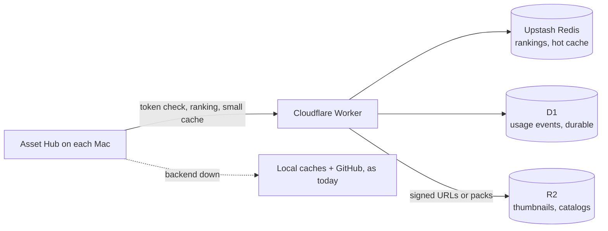

# Free-tier services for the Asset Hub backend

Researched 2026-11-09 (Asia/Saigon). Prices and limits change often; re-check the official pages linked below before signing up.

## Answer

**Cloudflare Workers + R2 + D1, with Upstash Redis, covers the planned backend for free with a wide margin.** It holds as long as thumbnails are served in batches rather than one request per file. Every other option either sleeps when idle, has no free tier, or is too small.

| Need | Service | Free limit | Expected use (8 users) | Headroom |
|---|---|---|---|---|
| API | Cloudflare Workers | 100,000 requests/day; 1,000/min burst; 10 ms CPU per request | ~1,000 requests/day steady; ~20,000 on a day a new Mac does its first thumbnail sync | Large, if thumbnails are batched |
| Redis (popularity ranking, hot cache) | Upstash Redis | 500K commands/month; 256 MB; 10 GB bandwidth/month | ~100K commands/month; ~5–20 MB | ~5x |
| Thumbnails and large cache files | Cloudflare R2 | 10 GB storage; 1M writes, 10M reads per month; egress free | 0.3 GB; ~20K writes once; ~200K reads/month | Large |
| Durable usage events | Cloudflare D1 | 5 GB per account (500 MB per database); 5M rows read, 100K rows written per day | ~200 rows written/day | Large |

## How the load was estimated

From the app's usage reports for Nov 1–9 (see the earlier analysis of the feedback repo):

- **Sessions:** about 165 a week across 8 people, or ~700 a month.
- **Branch opens:** about 585 a week, or ~2,500 a month.
- **Asset views:** about 900 a week, or ~3,900 a month.

The current shared index repo holds 19,648 thumbnails (242 MB, ~12 KB each) plus 49 MB of listings and measurements. This was measured with the GitHub API.

Assumptions:
- Each branch open makes ~5 backend calls (auth, ranking, cached listings).
- Each view makes ~3 calls (cached dependencies, one usage event).
- Each call costs 2–5 Redis commands.

That gives ~25K Worker requests and ~100K Redis commands a month. Even 5x the current use stays inside the free tiers.

## Constraints that shape the design

1. **Batch thumbnails.** One request per thumbnail means a new Mac makes ~20K requests. That fits the daily limit, but at full speed it hits the 1,000-requests-per-minute burst limit. Two fixes:
   - serve thumbnails in packs (for example, one file per folder or per few hundred thumbnails);
   - or link to private R2 objects with short-lived signed URLs, so thumbnail reads skip the Worker.
2. **Keep heavy work out of the Worker.** The free plan allows 10 ms of CPU per request. Checking tokens and repo access is waiting on the network, not CPU, so it fits. Parsing large catalog files inside the Worker would not. Store those files in R2 and send them as they are.
3. **Store thumbnails and large files in R2, not Redis.** Thumbnails and catalogs would use most of Redis's 256 MB and its 10 GB monthly bandwidth. Redis holds only rankings and small hot entries.
4. **Upstash archives a free database after 14 days without activity.** It keeps a backup. A long holiday such as Tết could trigger this. This is acceptable because Redis is rebuilt from the D1 events and the app already works without the backend, but someone has to restore or recreate the database afterwards.
5. **D1 enforces its daily limits.** Since 2026-09-01, D1 queries fail once a free account passes the daily row read or write limit. Index the columns you query; an unindexed scan counts every row read.

## Options rejected, and why

| Service | Free tier | Why it doesn't fit |
|---|---|---|
| Render | Web service sleeps after 15 min idle and takes ~1 min to wake; free Postgres expires after 30 days | The first request each morning would time out, so the app would treat the backend as down every day. |
| Fly.io | No free tier for new organizations (trial only) | Not free. |
| Railway | $1 of credit a month after a one-time $5 trial; 0.5 GB RAM per service | $1 does not keep a server and Redis running all month. |
| Redis Cloud | 30 MB; 100 operations/s; 5 GB bandwidth/month | Enough for rankings alone, but tight for a cache; it also deletes inactive databases. Upstash is larger and fits the Worker model. |
| Supabase | 500 MB Postgres, 1 GB files, 5 GB egress; pauses after 1 week idle | The pause causes the same morning-outage problem, and it has no Redis. It could replace D1 and R2 for Postgres-minded teams, at the cost of the pause. |

## Architecture this fits

## Next steps

1. Create a Cloudflare account owned by the company (Workers Free) and an Upstash account. No credit card is needed for either free tier.
2. In the plan, design thumbnail delivery as packs or signed R2 URLs, and keep Worker requests small.
3. Add usage alerts. Both dashboards show usage against the limits; check them weekly for the first month.
4. Upgrade when needed. Workers Paid ($5/month) removes the 10 ms CPU limit and adds 10M requests a month, and Upstash pay-as-you-go stays near $0 at this load.

## Sources

- [Cloudflare Workers pricing](https://developers.cloudflare.com/workers/platform/pricing/) and [limits](https://developers.cloudflare.com/workers/platform/limits/)
- [Cloudflare R2 pricing](https://developers.cloudflare.com/r2/pricing/)
- [Cloudflare D1 pricing](https://developers.cloudflare.com/d1/platform/pricing/), [limits](https://developers.cloudflare.com/d1/platform/limits), [free-tier enforcement changelog](https://developers.cloudflare.com/changelog/post/2026-09-01-d1-free-tier-limit-enforcement/)
- [Upstash Redis pricing](https://upstash.com/pricing/redis), [billing](https://upstash.com/docs/redis/overall/billing), [FAQ on archiving](https://upstash.com/docs/redis/help/faq)
- [Redis Cloud Essentials plans](https://redis.io/docs/latest/operate/rc/subscriptions/view-essentials-subscription/essentials-plan-details/)
- [Render: platforms with a free tier](https://render.com/articles/platforms-with-a-real-free-tier-for-developers-in-2026), [temps.sh on Render](https://temps.sh/blog/render-pricing-2026)
- [Railway free trial docs](https://docs.railway.com/pricing/free-trial), [Railway forum on the $1 credit](https://station.railway.com/billing/the-pricing-page-says-the-free-tier-is-aa5cf208)
- [temps.sh on Fly.io pricing](https://temps.sh/blog/fly-io-pricing-2026)
- [Supabase pricing](https://supabase.com/pricing)

## Unresolved questions

- Upstash shows both 250 MB and 256 MB for the free data size. It doesn't matter at this load.
- Fly.io and Railway figures come from third-party trackers, not their pricing pages.
- Does the company already have a Cloudflare account, or should a new one be created and owned by a team address?
